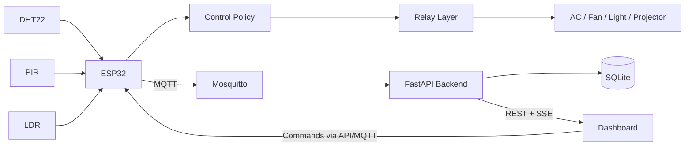

# Architecture

1. **Physical sensing and actuation:** DHT22, PIR, LDR, four relay modules, indicator loads, and projector button.
2. **Edge controller:** non-blocking ESP32 sampling, local occupancy/policy decisions, safe projector state machine, overrides, runtime and estimated energy. It remains autonomous without network service.
3. **Cloud telemetry and storage:** for this prototype, local Mosquitto + FastAPI + SQLite emulate the cloud layer. Telemetry validation precedes persistence.
4. **Application dashboard:** the backend serves a dependency-free responsive interface. REST handles queries/commands; SSE provides immediate telemetry with periodic refresh as fallback.

