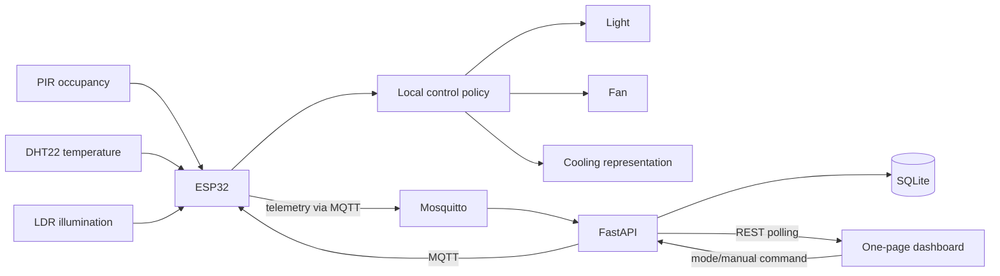

# System Architecture

## Design boundary

This system is a local, thesis-oriented research prototype. It has seven conceptual modules and no production deployment layer:

1. PIR, temperature, and illumination acquisition.
2. ESP32 smart decision algorithm.
3. Light, fan, and cooling output control.
4. MQTT communication.
5. SQLite logging and runtime-based energy estimation.
6. One-page monitoring/control dashboard.
7. Reproducible offline experiments and analysis.

## Responsibility boundaries

### ESP32

The ESP32 is the only authority for automatic decisions. Its main loop reads sensors, maintains the occupancy hold, calculates desired device states, changes outputs, tracks runtime, attempts network reconnection, and publishes telemetry. Network failure cannot block the sensor/control path.

### MQTT and FastAPI

MQTT provides the visible IoT communication layer. FastAPI validates incoming telemetry, calculates interval energy from runtime-counter deltas, persists compact observations, returns current/history/energy data, and publishes mode/manual commands. It does not reproduce the SMART control algorithm.

### SQLite

The single `telemetry` table records environmental inputs, mode, states, cumulative runtime counters, interval runtimes, per-device estimated energy, and switching totals. Existing local databases receive missing columns on startup so prior user data are not discarded.

### Dashboard

The browser polls `/api/status`, `/api/history`, and `/api/energy` every two seconds. It posts to `/api/mode` and `/api/control`. No SSE, WebSocket, frontend framework, authentication, or multi-page application is required.

### Offline experiment runner

The experiment runner is deliberately separate from live control. It reads deterministic CSV inputs and evaluates the same sequence with multiple strategies. This makes paired comparison reproducible without pretending Wokwi measures electrical power.

## Local autonomy failure case

If MQTT or FastAPI stops, `NetworkManager::loop` returns quickly and the firmware main loop continues to call sensor acquisition and `DeviceManager::update`. Telemetry and remote commands become unavailable, but SMART control continues. This behavior can be demonstrated by stopping Mosquitto while changing Wokwi sensor inputs.
