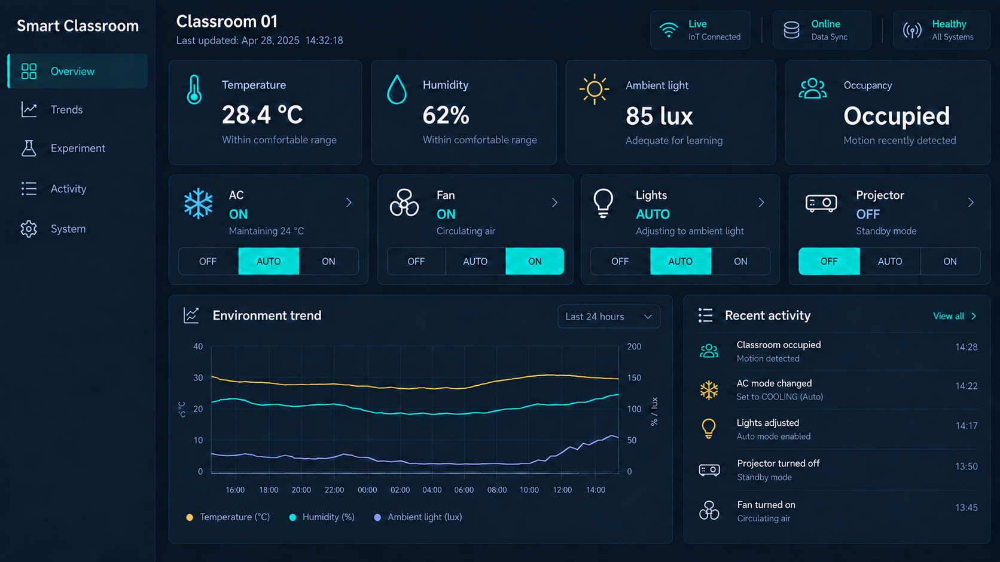

# Smart Classroom Implementation Blueprint

This is the concrete organization and visual specification for the next implementation. The broader product and backend rationale remains in [product-design-plan.md](product-design-plan.md).

> **Organization status:** the repository was migrated to this application-oriented structure on 2026-09-15. Items explicitly described as later architectural work—versioned APIs, acknowledgements, experiments, and the full redesigned UI—remain planned work.

## 1. Final repository organization

The repository should be a small monorepo with three applications—firmware, server, and dashboard—plus infrastructure, shared documentation, and end-to-end tests.

```text
SmartClassroom/
├── apps/
│   ├── firmware/                       ESP32/PlatformIO application
│   │   ├── platformio.ini
│   │   ├── include/
│   │   │   └── smart_classroom/
│   │   │       ├── config.h
│   │   │       ├── models.h
│   │   │       ├── sensors/
│   │   │       │   ├── sensor_manager.h
│   │   │       │   └── occupancy_manager.h
│   │   │       ├── control/
│   │   │       │   ├── control_policy.h
│   │   │       │   ├── device_manager.h
│   │   │       │   └── energy_tracker.h
│   │   │       └── connectivity/
│   │   │           ├── network_manager.h
│   │   │           └── telemetry_manager.h
│   │   ├── src/
│   │   │   ├── main.cpp                composition and main loop only
│   │   │   ├── sensors/
│   │   │   ├── control/
│   │   │   └── connectivity/
│   │   └── test/                       firmware-native tests
│   │
│   ├── server/                         FastAPI application
│   │   ├── pyproject.toml
│   │   ├── src/
│   │   │   └── smart_classroom_api/
│   │   │       ├── __init__.py
│   │   │       ├── main.py             create_app() and lifespan only
│   │   │       ├── config.py           validated environment settings
│   │   │       ├── api/
│   │   │       │   ├── dependencies.py
│   │   │       │   ├── errors.py
│   │   │       │   └── routes/
│   │   │       │       ├── health.py
│   │   │       │       ├── classrooms.py
│   │   │       │       ├── telemetry.py
│   │   │       │       ├── commands.py
│   │   │       │       ├── experiments.py
│   │   │       │       └── events.py
│   │   │       ├── domain/
│   │   │       │   ├── enums.py
│   │   │       │   ├── models.py
│   │   │       │   ├── energy.py
│   │   │       │   └── freshness.py
│   │   │       ├── services/
│   │   │       │   ├── telemetry_service.py
│   │   │       │   ├── command_service.py
│   │   │       │   ├── experiment_service.py
│   │   │       │   └── event_hub.py
│   │   │       └── infrastructure/
│   │   │           ├── database/
│   │   │           │   ├── connection.py
│   │   │           │   ├── migrations.py
│   │   │           │   └── repositories.py
│   │   │           └── mqtt/
│   │   │               ├── client.py
│   │   │               └── topics.py
│   │   └── tests/
│   │       ├── unit/
│   │       ├── integration/
│   │       └── fixtures/
│   │
│   └── dashboard/                      build-free web application
│       ├── index.html
│       ├── assets/
│       │   ├── icons/                  vendored Lucide SVG sprite/subset
│       │   └── favicon.svg
│       ├── css/
│       │   ├── tokens.css
│       │   ├── reset.css
│       │   ├── base.css
│       │   ├── layout.css
│       │   ├── components.css
│       │   └── utilities.css
│       └── js/
│           ├── app.js                  boot and route registration only
│           ├── router.js
│           ├── api-client.js
│           ├── event-stream.js
│           ├── store.js
│           ├── formatters.js
│           ├── constants.js
│           ├── components/
│           │   ├── app-shell.js
│           │   ├── health-chip.js
│           │   ├── metric-card.js
│           │   ├── device-card.js
│           │   ├── segmented-control.js
│           │   ├── trend-chart.js
│           │   ├── activity-list.js
│           │   ├── command-status.js
│           │   ├── dialog.js
│           │   └── toast.js
│           └── views/
│               ├── overview-view.js
│               ├── trends-view.js
│               ├── experiment-view.js
│               ├── activity-view.js
│               └── system-view.js
│
├── infra/
│   ├── compose.yaml
│   ├── mosquitto/
│   │   └── mosquitto.conf
│   └── docker/
│       └── server.Dockerfile
├── tests/
│   └── system/                         MQTT/API/device contract scenarios
├── scripts/
│   ├── dev.ps1                         start broker + server
│   ├── test.ps1                        run all available test suites
│   └── seed_demo.py                    explicit demo data; never auto-runs
├── scenarios/                          Wokwi demonstration scenarios
├── docs/
│   ├── assets/
│   ├── architecture.md
│   ├── requirements.md
│   ├── api.md
│   ├── mqtt-contracts.md
│   ├── product-design-plan.md
│   ├── implementation-blueprint.md
│   └── ...
├── .env.example
├── .gitignore
├── README.md
├── LICENSE
└── Makefile or Taskfile.yml            optional cross-platform shortcuts
```

### Why this structure

- `apps/` answers the first question a new developer has: “what actually runs?”
- Firmware, server, and dashboard no longer mix files or tests.
- HTTP, application logic, domain rules, storage, and MQTT each have one clear owner.
- Infrastructure is configuration, not application code.
- System tests sit above all applications because they verify their contracts together.
- Documentation and mockups remain discoverable without polluting runtime directories.

Do not create a generic `utils/` directory. A helper belongs next to the feature that owns it; truly shared formatting belongs in one explicitly named file such as `formatters.js`.

## 2. Completed migration map

| Original location | Current location | Treatment |
|---|---|---|
| `src/*.cpp` | `apps/firmware/src/{sensors,control,connectivity}/` | Move by responsibility; keep `main.cpp` at root |
| `include/*.h` | `apps/firmware/include/smart_classroom/...` | Mirror firmware source folders |
| `platformio.ini` | `apps/firmware/platformio.ini` | Update include/test paths and README commands |
| `test/test_policy.py` | `apps/server/tests/unit/test_reference_policy.py` | Retained as an explicit reference implementation |
| `test/test_backend.py` | `apps/server/tests/integration/` | Split by route/service/repository behavior |
| `backend/app.py` | `apps/server/src/smart_classroom_api/main.py` + `api/routes/*` | Decomposed; database and MQTT globals removed from route module |
| `backend/models.py` | `apps/server/src/smart_classroom_api/domain/models.py` | Domain/wire separation can continue with the versioned API |
| `backend/database.py` | `apps/server/src/smart_classroom_api/infrastructure/database/` | Repository isolated; migrations remain planned |
| `backend/mqtt_service.py` | `apps/server/src/smart_classroom_api/infrastructure/mqtt/client.py` | MQTT transport isolated |
| `backend/policy.py` | `apps/server/src/smart_classroom_api/domain/reference_policy.py` | Retained only as a hardware-independent test reference |
| `backend/static/*` | `apps/dashboard/{css,js}/` | Split into HTML, API client, chart, application, and CSS modules |
| `mosquitto/`, `docker-compose.yml` | `infra/` | Runtime configuration moved together |
| Root Wokwi files | `apps/firmware/` where supported | Keep simulator paths beside firmware |

Migrate one vertical slice at a time. Do not perform a single rename-only rewrite that leaves broken imports and tests.

## 3. Code ownership rules

### Firmware

- `main.cpp` constructs managers and calls `begin()`/`tick()`; it contains no policy equations.
- Sensors return validated readings; they do not control relays.
- `ControlPolicy` decides desired states; `DeviceManager` performs safe transitions.
- `TelemetryManager` serializes snapshots and acknowledgements; it does not calculate control policy.
- `NetworkManager` owns Wi-Fi/MQTT lifecycle and reconnect timing.
- Configuration constants live in `config.h`; secrets never do.

### Server

- Routes parse HTTP and call one service method.
- Services own use cases and transactions.
- Repositories are the only modules allowed to execute SQL.
- The MQTT adapter is the only module allowed to call Paho.
- Domain code imports neither FastAPI, sqlite3, nor Paho.
- Pydantic request/response models never leak a database row directly.
- `create_app(settings, repositories, mqtt)` supports dependency injection in tests.

### Dashboard

- Views arrange components and request data; they do not contain raw fetch logic.
- `api-client.js` is the only module allowed to call `fetch`.
- `event-stream.js` is the only module allowed to construct `EventSource`.
- `store.js` owns client state; components receive data and emit semantic events.
- Components never inject untrusted strings with `innerHTML`; use DOM APIs/text content.
- CSS classes describe components (`device-card`), not accidental appearance (`blue-box`).

## 4. Naming conventions

| Area | Convention | Example |
|---|---|---|
| Python files/functions | `snake_case` | `create_command`, `command_service.py` |
| Python classes | `PascalCase` | `CommandService` |
| JavaScript files | `kebab-case` | `device-card.js` |
| JavaScript functions/variables | `camelCase` | `renderSnapshot` |
| C++ classes | `PascalCase` | `SensorManager` |
| C++ methods/variables | existing `camelCase` consistently | `publishTelemetry` |
| REST resources | plural nouns, kebab-free identifiers | `/api/v1/classrooms/{id}/commands` |
| MQTT topics | lowercase path segments | `smartclassroom/v1/classrooms/{id}/telemetry` |
| Database | `snake_case`, plural tables | `device_samples` |
| CSS | component + element + modifier | `.device-card__state`, `.is-stale` |

Avoid abbreviations except established domain terms (`api`, `mqtt`, `sse`, `id`). Use `lights` consistently; do not mix `light` and `lights` as device identifiers.

## 5. UI direction



The mockup is the hierarchy and styling reference, not a literal data contract. The real product must only display values the hardware can measure; the PIR provides occupied/unoccupied, not a people count.

### Page shell

```text
Desktop ≥ 1100 px
┌──────── 240 px sidebar ────────┬──────── flexible content ─────────────┐
│ Product name                   │ Classroom 01       health indicators │
│                                │ last update / mode                    │
│ Overview                       ├───────────────────────────────────────┤
│ Trends                         │ page content                          │
│ Experiment                     │                                       │
│ Activity                       │                                       │
│ System                         │                                       │
│                                │                                       │
│ v1.0                           │                                       │
└────────────────────────────────┴───────────────────────────────────────┘
```

- Sidebar: 240 px expanded; 72 px icon rail between 768–1099 px; mobile drawer below 768 px.
- Content maximum width: 1440 px. Page padding: 24 px desktop, 16 px mobile.
- Header height: 80 px desktop, 64 px mobile.
- Main grid: 12 columns, 16 px gutters.
- Metric/device cards: 3 columns each on desktop, 6 on tablet, 12 on mobile.
- Trend panel: 8 columns; activity panel: 4 columns.

## 6. Navigation and icon map

Use **Lucide** outline icons as a small locally vendored SVG subset. Keep the default 24 × 24 view box, `stroke="currentColor"`, rounded line caps, and a consistent 2 px stroke. Lucide supports package-based use and visual customization, which fits the build-free dashboard when a selected SVG subset is vendored locally ([official Lucide site](https://lucide.dev/)).

Icons never appear alone when the action could be ambiguous. Sidebar icons have labels; icon-only buttons require an accessible name and tooltip.

### Primary navigation

| Location | Lucide icon | Label | Purpose |
|---|---|---|---|
| Sidebar 1 | `LayoutDashboard` | Overview | Live room summary and controls |
| Sidebar 2 | `ChartNoAxesCombined` | Trends | Sensor/device history |
| Sidebar 3 | `FlaskConical` | Experiment | Energy comparison runs |
| Sidebar 4 | `ListFilter` | Activity | Events and command audit trail |
| Sidebar 5 | `Settings` | System | Connectivity and configuration summary |

### Header health

| Meaning | Lucide icon | Placement |
|---|---|---|
| Device/telemetry link | `RadioTower` | First health chip |
| MQTT broker | `Wifi` / `WifiOff` | Second health chip |
| Database | `Database` | Third health chip |
| Fresh/live | `CircleCheck` | Global status badge |
| Stale | `Clock3` | Global status badge |
| Warning | `TriangleAlert` | Banner and affected card |

On screens below 900 px, collapse the three health chips into one “System health” button with the worst current status; details open in a popover or the System view.

### Environment metrics

| Metric | Lucide icon | Supporting copy |
|---|---|---|
| Temperature | `Thermometer` | `Updated 3s ago` or `Sensor unavailable` |
| Humidity | `Droplets` | Unit is `% RH` |
| Ambient light | `SunMedium` | Always label as estimated lux |
| Occupancy | `Users` | `Motion recently detected` or `No recent motion` |

Do not say “3 people detected”: the PIR cannot count people.

### Equipment

| Device | Lucide icon | State wording |
|---|---|---|
| AC | `Snowflake` | ON/OFF only |
| Fan | `Fan` | ON/OFF only |
| Lights | `Lightbulb` | ON/OFF only |
| Projector | `Projector` | ON/OFF/COOLING DOWN |

### Common actions

| Action | Lucide icon | Rule |
|---|---|---|
| Return to AUTO | `Bot` | Icon accompanies `AUTO`; never icon-only |
| Force on/off | `Power` | Use inside the confirmation summary, not all three segment labels |
| Refresh | `RefreshCw` | Manual retry only; SSE normally updates automatically |
| Date range | `CalendarDays` | Left side of range control |
| Filter | `SlidersHorizontal` | Activity filters |
| Export | `Download` | Experiment/results toolbar |
| Reset statistics | `RotateCcw` | Destructive secondary action with confirmation |
| More details | `ChevronRight` | End of clickable cards/rows |
| Close | `X` | Dialog top-right plus Cancel button |
| Success | `CircleCheck` | Command applied |
| Rejected/error | `CircleX` | Command rejected or request failed |
| Waiting | `LoaderCircle` | Animated only while pending; respect reduced motion |

## 7. Design tokens

Use one token source in `tokens.css`; components must not introduce random hex values.

```css
:root {
  color-scheme: dark;

  --color-bg: #0b1220;
  --color-surface: #111c2e;
  --color-surface-raised: #162338;
  --color-border: #24324a;
  --color-border-strong: #344661;

  --color-text: #f3f7fc;
  --color-text-muted: #9bacc2;
  --color-text-disabled: #64748b;

  --color-accent: #22d3c5;
  --color-accent-soft: #143b40;
  --color-warning: #f6b94a;
  --color-warning-soft: #3c301b;
  --color-danger: #ef6461;
  --color-danger-soft: #3f2227;
  --color-info: #7c9cff;

  --space-1: 4px;
  --space-2: 8px;
  --space-3: 12px;
  --space-4: 16px;
  --space-5: 24px;
  --space-6: 32px;
  --space-7: 48px;

  --radius-control: 8px;
  --radius-card: 12px;
  --shadow-raised: 0 12px 32px rgb(0 0 0 / 18%);
  --focus-ring: 0 0 0 3px rgb(34 211 197 / 35%);
}
```

### Typography

- Font: `Inter`, with `Segoe UI`, `Roboto`, and `sans-serif` fallbacks. Bundle Inter only if offline licensing/assets are maintained; otherwise the system stack is acceptable.
- Page title: 28/34 px, weight 700.
- Section title: 18/26 px, weight 650.
- Metric value: 36/42 px, weight 700, tabular numbers.
- Card title/body: 16/24 px and 14/20 px.
- Label/caption: 12/16 px; never smaller.
- Avoid uppercase paragraphs. Uppercase may be used for short states such as `AUTO` and `OFF`.

## 8. Overview layout and content

### Header

Left:

- `Classroom 01` page title.
- Under it: `Last update 3 seconds ago · AUTO mode`.

Right:

- Device, MQTT, and database health chips.
- Do not show a green “Live” state if the latest telemetry is stale.

### Environment row

Each card contains, in order:

1. Icon in a 40 px non-clickable container.
2. Metric label.
3. Large value and unit.
4. Freshness or warning sentence.

Unknown readings must display `Unavailable`, not `0` or an em dash without explanation.

### Equipment row

Each card contains:

1. Device icon and name.
2. Actual state badge (`ON`, `OFF`, or `COOLING DOWN`).
3. Reason sentence such as `Room occupied · 30.2 °C`.
4. Override segmented control in the order `AUTO | ON | OFF`.
5. Compact footer: `Runtime 12m · Est. 5.2 Wh`.
6. Pending command status directly under the control.

Actual state and selected override are deliberately separate. A device can be OFF while AUTO is selected; that is correct and must not look contradictory.

### Bottom row

- Left 8 columns: 60-minute environment chart with a range selector. Temperature and humidity may share a panel with separate axes; lux should be toggled or separate, not silently normalized.
- Right 4 columns: latest five meaningful events and a `View all` link.
- On mobile, cards stack before charts; Activity follows Trends.

## 9. Other pages

### Trends

Top toolbar: date/range control, metric selector, and export. Below it:

1. Temperature and humidity line chart.
2. Lux line chart.
3. Occupancy step chart.
4. Equipment-state timelines.
5. Estimated energy accumulation/chart.

Every chart has title, unit, time zone, legend, empty/error state, and a “View as table” accessibility option.

### Experiment

Top warning panel: `Energy is estimated from nominal power × runtime; it is not meter data.`

Then:

1. Experiment status and elapsed time.
2. Primary action: Start/Stop run.
3. AUTO versus CONVENTIONAL summary cards.
4. Saving ratio and device breakdown.
5. Coverage warning when run durations/samples differ.
6. Export button.
7. Reset experiment as a danger-zone action at the bottom—not in the global header.

### Activity

- Search plus category chips: All, Commands, Devices, Sensors, Network, System.
- Each row: semantic icon, main sentence, metadata, timestamp, and expandable details.
- Command row example: `AC override changed to ON` / `Applied by classroom-01 in 320 ms`.
- Pagination or “Load more”; no unlimited scroll container nested inside the page.

### System

Use sections, not dashboard cards for every value:

- Classroom device: ID, firmware, boot ID, last seen.
- Connectivity: Wi-Fi/device, MQTT broker, SSE client.
- Storage/API: database, API version, retention summary.
- Sensor health: last valid reading and error state.
- Read-only configuration: thresholds, delays, nominal wattages.

## 10. Interaction rules

### Device command

```text
Idle → Confirming → Sending → Awaiting device → Applied
                                     ├─────────→ Rejected
                                     └─────────→ Timed out
```

- Confirm ON/OFF overrides; returning to AUTO may apply immediately with an undo toast.
- Disable only the relevant device control while its command is pending.
- “Published” is not success; wait for acknowledgement or confirming telemetry.
- Projector OFF confirmation says: `The projector will enter an 8-second cool-down before turning off.`
- Toasts summarize outcomes, but persistent state remains on the device card and Activity page.

### Mode change

- Display AUTO and CONVENTIONAL in a labeled two-option control near the page title or in Experiment.
- Confirmation describes the scope: `This changes automatic behavior for AC, fan, and lights.`
- Never place it visually inside one device card.

### Stale/offline behavior

- After 15 seconds without telemetry: amber `Stale` badge, values retain last known content with timestamp, controls disabled.
- After 60 seconds: red/neutral `Device offline`, hide “live” animation, keep historical access.
- Backend/MQTT failures are distinct; the user should know whether reading history still works.

## 11. Component API sketch

Components should consume view models, not raw API payloads.

```js
renderDeviceCard({
  id: 'ac',
  label: 'AC',
  icon: 'snowflake',
  actualState: 'ON',
  override: 'AUTO',
  reason: 'Room occupied · 30.2 °C',
  runtimeLabel: '12 min',
  energyLabel: '5.20 Wh estimated',
  freshness: 'live',
  command: null,
});
```

Map raw API fields to UI view models in the view/store layer. This prevents components from growing backend-specific conditionals.

## 12. What to remove from the current implementation

- One-line/minified Python, JavaScript, and CSS formatting.
- Module-level `db`, MQTT client, event loop, and subscriber globals.
- Inline `onclick` HTML and string-generated unescaped UI.
- A single canvas that plots unrelated units without understandable axes.
- Five-second refetching of every dataset while SSE is already healthy.
- Reset statistics in the main toolbar without confirmation.
- Green/live wording based on payload flags alone.
- Treating every device sample as a device-change event.
- Returning “queued locally” when there is no durable queue.
- Energy comparison based on unrelated latest cumulative totals.
- `__pycache__`, `.pytest_cache`, `.pio`, virtual environments, databases, and generated runtime files in the project source tree or archive.

## 13. Root hygiene rules

The repository root should contain only entry documentation and workspace-wide configuration. Add/confirm ignore rules for:

```gitignore
.env
.venv/
**/__pycache__/
.pytest_cache/
.pio/
*.py[cod]
*.db
*.db-shm
*.db-wal
coverage/
htmlcov/
dist/
```

Keep `.env.example`; move the live SQLite file to a configurable `data/` directory outside tracked source. Do not commit compiled firmware output.

## 14. Implementation order

1. Add contracts and characterization tests around the current system.
2. Create the target folders and move firmware without changing behavior.
3. Introduce the server application factory, settings, repositories, and migrations.
4. Add command acknowledgements/freshness before redesigning device controls.
5. Build the dashboard shell, tokens, icons, and Overview using fixture data.
6. Connect Overview to the versioned API/SSE contract.
7. Add Trends, Activity, Experiment, and System one at a time.
8. Remove compatibility routes/files only after their replacements pass tests.
9. Clean generated artifacts and update all start/test/demo documentation.

The first implementation milestone should deliver a clean folder layout plus a functioning Overview without changing edge automation behavior.
