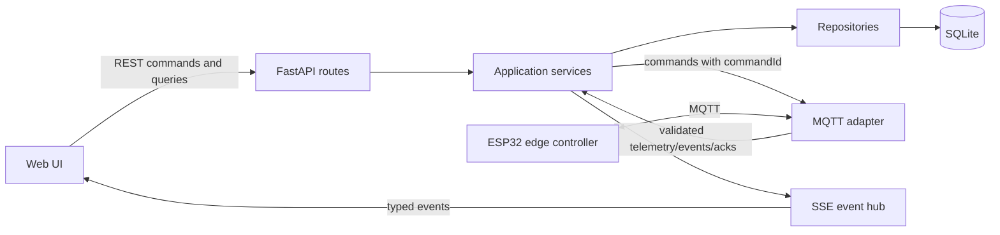

# Smart Classroom Product, UI/UX, and Backend Design Plan

## 1. Purpose

This document defines the next version of the Smart Classroom dashboard and backend. It turns the current working prototype into a maintainable, presentation-ready product without weakening the ESP32's local safety and automation behavior. For the exact target tree, icon map, dimensions, design tokens, and current-file migration map, see [implementation-blueprint.md](implementation-blueprint.md).

The design is deliberately split into two horizons:

- **Release 1 — polished academic prototype:** one classroom, local Mosquitto, FastAPI, SQLite, Server-Sent Events (SSE), and a dependency-light web interface.
- **Later deployment:** multiple classrooms, authenticated users, PostgreSQL, TLS MQTT, alerts, and operational administration.

Release 1 must be complete before deployment features are added.

## 2. Product goals and non-goals

### Goals

1. Let a presenter understand classroom conditions and equipment state in under five seconds.
2. Make every remote action explicit, safe, and traceable.
3. Distinguish live data, stale data, backend health, MQTT health, and device availability.
4. Make automated-versus-conventional energy results easy to explain and academically defensible.
5. Keep edge automation operational if the dashboard, backend, Wi-Fi, or broker is unavailable.
6. Give the backend clear boundaries so that routes, MQTT, policy-facing commands, storage, and live updates can be tested independently.
7. Keep the local demonstration easy to start and free of paid services.

### Non-goals for Release 1

- Building a campus-wide building-management system.
- Moving the control policy from the ESP32 to the backend.
- Claiming measured energy when values are estimated from nominal power and runtime.
- Predictive optimization, machine learning, billing, scheduling, or mobile applications.
- Full user management or cloud deployment before local behavior is reliable.

## 3. Users and primary jobs

| User | Primary job | Needed information | Allowed actions in Release 1 |
|---|---|---|---|
| Classroom operator | Check the room and correct an immediate equipment state | Live environment, occupancy, device state, override, command result | AUTO/ON/OFF, mode change |
| Researcher/presenter | Demonstrate behavior and evaluate energy savings | Live trends, runtime, energy methodology, experiment status, event history | Start/reset an experiment, export data |
| Maintainer | Diagnose why data or control is not working | Device freshness, sensor errors, MQTT/backend status, rejected commands | View diagnostics; configuration remains file-based |
| Viewer | Observe without changing equipment | Overview and history | Read-only; a later authenticated deployment role |

The Release 1 UI may expose all controls locally, but its layout and API should preserve the distinction between viewing, operating, and administration.

## 4. UX principles

- **Status before analytics:** current room safety and device state always appear before charts.
- **State and intent are different:** show actual device state separately from AUTO/FORCE_ON/FORCE_OFF.
- **Never imply success too early:** “command sent” is not “device changed.”
- **Staleness is visible:** display the last telemetry time and stop presenting old values as live.
- **Safety states are first-class:** projector `COOLING_DOWN` cannot look like OFF.
- **Explain estimates:** every energy surface labels values as estimated and exposes the nominal-power model.
- **Progressive disclosure:** the overview stays simple; experiment details, diagnostics, and raw logs live on focused screens.
- **Accessible by default:** semantic controls, keyboard focus, non-color status cues, readable contrast, and reduced-motion support.

## 5. Information architecture

Use a compact top navigation on laptop and a bottom/navigation drawer pattern on narrow screens.

```text
Smart Classroom
├── Overview          live room and equipment control
├── Trends            environment, occupancy, runtime, and energy history
├── Experiment        AUTO versus CONVENTIONAL comparison and reset/export
├── Activity          commands, state changes, sensor/network errors
└── System            connectivity, device freshness, configuration summary
```

For Release 1, these may be URL-addressable views inside one lightweight web application. Avoid modal-heavy navigation.

## 6. Core user flows

### 6.1 Monitor the classroom

1. Open Overview.
2. Read overall state: online/stale/offline, occupancy, mode, and sensor condition.
3. Scan temperature, humidity, and ambient light.
4. Scan device cards for state, override, reason, runtime, and estimated energy.
5. Open Trends only when historical context is needed.

Success criterion: the user can correctly state room occupancy, operating mode, connectivity, and all four equipment states in under five seconds.

### 6.2 Override equipment

1. Select AUTO, ON, or OFF on a device card.
2. UI shows a short confirmation for consequential actions, including device, requested mode, and safety implication.
3. Backend creates a command with a unique `commandId` and returns `202 Accepted`.
4. Card shows `Sending…`, then `Awaiting device…`.
5. ESP32 acknowledges or telemetry confirms the new override/state.
6. UI shows `Applied`, `Rejected`, or `Timed out`; Activity records the complete lifecycle.

Projector OFF must explain that power remains active during cool-down. A timeout must not silently revert the displayed actual state.

### 6.3 Run an energy experiment

1. Open Experiment and review the estimation disclaimer and baseline assumption.
2. Reset the selected experiment only after confirmation.
3. Run CONVENTIONAL and AUTO intervals separately.
4. Show duration and sample coverage for each interval, not only cumulative Wh.
5. Compare totals and device breakdowns.
6. Export CSV/JSON plus the experiment metadata.

Success criterion: a reviewer can identify the assumptions, compared durations, data coverage, equation, and device contribution without reading source code.

### 6.4 Diagnose missing data

1. Global status changes from Live to Stale after the configured freshness limit.
2. System shows backend, broker, and classroom-device status separately.
3. The most likely cause and last-seen timestamps are displayed.
4. Activity can be filtered to sensor, network, device, and command events.

## 7. Screen specifications

### 7.1 Overview

```text
┌ Smart Classroom · Classroom 01 ───────── [LIVE ●] [AUTO] ┐
│ Last update 3s ago · Backend OK · Broker OK · Device OK  │
├──────────┬──────────┬──────────┬──────────────────────────┤
│ 28.4 °C  │ 62% RH   │ 85 lux   │ Occupied                 │
├──────────┴──────────┴──────────┴──────────────────────────┤
│ AC              Fan             Lights          Projector │
│ ON · AUTO       ON · AUTO       OFF · AUTO      COOLING   │
│ reason…         reason…         reason…         06s left  │
│ [AUTO ON OFF]   [AUTO ON OFF]   [AUTO ON OFF]   [controls]│
├────────────────────────────────────────────────────────────┤
│ Active notices / command progress                          │
└────────────────────────────────────────────────────────────┘
```

Requirements:

- The header contains classroom name, freshness, operating mode, and a compact health summary.
- Environment cards show value, unit, quality/warning, and last update. Humidity must not be omitted from history.
- Device cards show actual state, override mode, reason, runtime, estimated energy, and command progress.
- The selected override control has `aria-pressed="true"`; ON/OFF/AUTO labels include accessible text.
- Controls are disabled when data is stale or the device is offline unless an explicitly documented “queue command” behavior is implemented.
- Mode switching is visually separated from per-device overrides and includes a description of CONVENTIONAL behavior.
- Reset is not on the Overview toolbar; it belongs in Experiment/System to prevent accidental use.

### 7.2 Trends

- Time range: last 15 minutes, hour, session, and custom range.
- Separate or switchable charts for temperature/humidity, illuminance, occupancy, device state/runtime, and energy.
- Do not place temperature and lux on the same unlabeled scale.
- Charts include axes, units, timestamps, legends, accessible summaries, empty states, and loading/error states.
- Occupancy and device state use step plots; continuous sensors use lines.
- Down-sample long ranges on the backend to keep browser rendering predictable.

### 7.3 Experiment

- Prominent “estimated, not metered” badge and formula.
- AUTO and CONVENTIONAL comparison with equal-duration/data-coverage warning.
- Total Wh, saved Wh, saving ratio, and device-by-device breakdown.
- Session start/end, elapsed time, sample count, and assumptions.
- Reset actions identify exactly which data/counters are affected and require confirmation.
- Export JSON and CSV from backend-generated datasets.

### 7.4 Activity

- Unified chronological feed with filters: command, state, sensor, network, system.
- Each command row shows requested value, source, publish result, acknowledgement result, and completion time.
- Human-readable summary is primary; technical details can expand.
- Pagination/cursor loading replaces a fixed unbounded DOM list.

### 7.5 System

- Backend uptime/version, database status, MQTT connection, configured broker (without secrets), and SSE state.
- Device ID, firmware version, boot ID, IP/network flags where available, and last seen.
- Sensor health and last valid readings.
- Thresholds and nominal wattages are read-only in Release 1 unless configuration editing is explicitly added and validated end to end.

## 8. Visual system

Keep the current dark control-room character, but formalize it with reusable tokens.

### Tokens

- Surfaces: page, panel, elevated panel, border.
- Text: primary, secondary, disabled.
- Semantic colors: healthy, warning, critical, informational, neutral.
- Status must pair color with icon and text.
- Spacing: 4/8/12/16/24/32 px scale.
- Radius: 8 px controls, 12–16 px cards.
- Type: system font stack; tabular numerals for telemetry.

### Responsive behavior

- Desktop/laptop: four environment metrics and four device cards when space permits.
- Tablet: two-column cards, charts full width.
- Mobile: one column; sticky compact room status; minimum 44 × 44 px controls.
- Charts must resize their drawing buffer, not only their CSS size, to avoid blur.

### Required component states

Every data component defines: loading, live, stale, empty, warning, error, and unavailable. Every command control defines: idle, confirming, sending, awaiting acknowledgement, applied, rejected, timed out, and disabled.

## 9. Recommended frontend structure

Keep Release 1 dependency-light and use semantic HTML, CSS, and JavaScript ES modules. A framework migration is not necessary for five focused views and would increase setup risk during demonstrations.

```text
apps/dashboard/
├── index.html
├── css/
│   ├── tokens.css
│   ├── base.css
│   ├── components.css
│   └── layouts.css
└── js/
    ├── app.js
    ├── api.js
    ├── stream.js
    ├── store.js
    ├── format.js
    ├── components/
    │   ├── status-badge.js
    │   ├── metric-card.js
    │   ├── device-card.js
    │   ├── chart.js
    │   ├── command-feedback.js
    │   └── event-list.js
    └── views/
        ├── overview.js
        ├── trends.js
        ├── experiment.js
        ├── activity.js
        └── system.js
```

The UI store holds `latestTelemetry`, `health`, `pendingCommands`, `connectionState`, and the active view. SSE updates live state; REST loads initial and historical data. On SSE failure, use exponential reconnect and a slower polling fallback. Do not run a full five-second refresh of energy, events, status, and history while SSE is healthy.

## 10. Backend target architecture

The ESP32 remains the control authority. The backend validates, stores, queries, publishes commands, correlates acknowledgements, and serves clients.



### Layer responsibilities

| Layer | Owns | Must not own |
|---|---|---|
| API routes | HTTP validation, status codes, response models | SQL, MQTT callbacks, energy formulas |
| Application services | Command lifecycle, telemetry ingestion, energy/experiment queries | FastAPI response objects |
| Domain models | Device/state enums, freshness rules, calculation rules | Database connections |
| Repositories | SQL and transactions | HTTP or MQTT transport behavior |
| MQTT adapter | Connection/reconnect, subscribe/publish, transport parsing | Direct UI subscriber queues or business queries |
| SSE hub | Bounded subscribers, event types, keepalive | Database writes |

### Recommended package layout

```text
apps/server/src/smart_classroom_api/
├── main.py                application factory and lifespan only
├── config.py              validated environment settings
├── api/
│   ├── dependencies.py
│   └── routes/
│       ├── health.py
│       ├── classrooms.py
│       ├── telemetry.py
│       ├── commands.py
│       ├── experiments.py
│       └── events.py
├── domain/
│   ├── models.py
│   ├── enums.py
│   └── energy.py
├── services/
│   ├── telemetry.py
│   ├── commands.py
│   ├── experiments.py
│   └── event_hub.py
└── infrastructure/
    ├── database/
    │   ├── migrations.py
    │   └── repository.py
    └── mqtt/
        └── client.py
```

Use an application factory so tests can inject a temporary database and fake MQTT adapter without reloading module globals.

## 11. Data and event contracts

### Telemetry envelope

Add versioning and identity fields while preserving the compact device payload:

```json
{
  "schemaVersion": 1,
  "messageId": "classroom-01:boot-7:124",
  "deviceId": "classroom-01",
  "bootId": "boot-7",
  "sequence": 124,
  "sentAt": "optional device timestamp",
  "uptimeMs": 123456,
  "temperatureC": 28.4,
  "humidityPct": 62.1,
  "illuminanceLux": 85,
  "occupied": true,
  "mode": "AUTO",
  "devices": {},
  "estimatedEnergyWh": {},
  "network": {}
}
```

The backend supplies `receivedAt`. `messageId` or `(deviceId, bootId, sequence)` supports duplicate detection. Device time is not trusted as the only ordering source.

### Command envelope

```json
{
  "schemaVersion": 1,
  "commandId": "uuid",
  "deviceId": "classroom-01",
  "type": "SET_OVERRIDE",
  "target": "ac",
  "value": "FORCE_ON",
  "requestedAt": "server UTC timestamp"
}
```

### Acknowledgement envelope

```json
{
  "schemaVersion": 1,
  "commandId": "uuid",
  "deviceId": "classroom-01",
  "status": "APPLIED",
  "actualState": "ON",
  "actualOverride": "FORCE_ON",
  "reason": "REMOTE_OVERRIDE"
}
```

Allowed acknowledgement statuses: `RECEIVED`, `APPLIED`, and `REJECTED`. The backend derives `TIMED_OUT`. MQTT publish success only means the broker accepted the publish; it is not a device acknowledgement.

### SSE event types

- `telemetry.updated`
- `device.changed`
- `command.updated`
- `health.updated`
- `experiment.updated`
- `system.notice`

Each event contains `eventId`, `type`, `occurredAt`, `deviceId`, and `data`. Support `Last-Event-ID` or perform a full state refresh after reconnect.

## 12. Database design

Keep SQLite for Release 1, enable foreign keys and WAL mode, and introduce numbered migrations rather than creating all schema inline at import time.

| Table | Important fields | Notes |
|---|---|---|
| `classrooms` | id, display_name, timezone, active | One row now; multi-room-ready |
| `telemetry` | id, classroom_id, message_id, received_at, sensor fields, mode, payload_json | Unique message ID; indexed by classroom/time |
| `device_samples` | telemetry_id, device, state, override, runtime_seconds, energy_wh, reason | Child samples; avoid an independent timestamp copy |
| `commands` | id/command_id, classroom_id, target, type, value, source, requested_at, published_at, acknowledged_at, status, result | Complete command lifecycle |
| `events` | id, classroom_id, occurred_at, category, severity, source, message, details_json | True domain/network/sensor events, not one row per unchanged sample |
| `experiment_runs` | id, classroom_id, mode, started_at, ended_at, baseline_assumption, status | Defines comparable windows |
| `schema_migrations` | version, applied_at | Repeatable initialization/upgrades |

Important corrections to the current storage model:

- Record device state events only when state/override/reason changes; do not present every telemetry snapshot as a “state change.”
- Store command outcomes beyond broker publish success.
- Make telemetry insertion, child device samples, and derived events one transaction.
- Define a retention policy. For the demo, keep raw telemetry for the project session and provide an explicit maintenance command; for deployment, aggregate and expire old raw samples.
- Do not compute experiment savings by comparing unrelated latest cumulative counters. Calculate within explicit experiment windows or counter baselines.

## 13. REST API v1

Use `/api/v1` for the redesigned contract. Keep existing endpoints temporarily as compatibility adapters during migration.

| Method and path | Purpose | Main behavior |
|---|---|---|
| `GET /api/v1/health` | Liveness/readiness and components | Backend, DB, broker; no fake overall “OK” |
| `GET /api/v1/classrooms` | Available rooms | One result in Release 1 |
| `GET /api/v1/classrooms/{id}/snapshot` | Initial Overview state | Latest telemetry, freshness, devices, health |
| `GET /api/v1/classrooms/{id}/telemetry` | Time-range history | `from`, `to`, `resolution`, metric filters |
| `GET /api/v1/classrooms/{id}/events` | Filtered activity | Category/severity filters and cursor pagination |
| `GET /api/v1/classrooms/{id}/energy` | Time-window energy summary | Explicit dates or experiment ID |
| `POST /api/v1/classrooms/{id}/commands` | Create a device/system command | Returns `202` and command resource |
| `GET /api/v1/commands/{commandId}` | Read command lifecycle | Pending/applied/rejected/timed out |
| `POST /api/v1/classrooms/{id}/experiments` | Start a run | Validates no conflicting active run |
| `POST /api/v1/experiments/{id}/stop` | Stop a run | Freezes comparison window |
| `GET /api/v1/experiments/{id}` | Results and assumptions | Includes coverage and device breakdown |
| `GET /api/v1/classrooms/{id}/stream` | Live typed SSE events | Auth-ready, bounded, reconnectable |
| `GET /api/v1/experiments/{id}/export` | CSV or JSON data | Backend-generated reproducible export |

API rules:

- Use typed request and response models; do not return arbitrary payload dictionaries from route code.
- Use UTC ISO 8601 timestamps and include the classroom timezone separately for display.
- Use consistent errors: `{ "error": { "code", "message", "details", "requestId" } }`.
- Use `202 Accepted` for asynchronous commands, `409 Conflict` for unsafe/conflicting state, `422` for validation, and `503` when a required component cannot accept work.
- Add OpenAPI descriptions and examples for all public endpoints.
- Set explicit history limits, time-range limits, and pagination.

## 14. Reliability and concurrency

- Replace module-level database, loop, subscriber, and MQTT globals with lifespan-managed application state.
- An MQTT callback thread must hand validated work to the application safely; bounded queues need an overflow policy and metrics.
- A full SSE subscriber must not raise `QueueFull` in the MQTT callback. Coalesce telemetry updates or drop the oldest telemetry event, never command acknowledgements.
- Configure MQTT reconnect backoff, Last Will/availability, QoS appropriate to message type, and retained availability/state where safe.
- Mark a classroom stale using server receipt time. Suggested defaults: stale after 15 seconds, offline after 60 seconds; make these configurable relative to telemetry frequency.
- Reject duplicate telemetry IDs and ignore out-of-order samples for the live snapshot while retaining them when diagnostically useful.
- Use structured logs with request ID, classroom/device ID, command ID, and event category.
- Health endpoints distinguish liveness (process running) from readiness (database available; broker status reported but local read-only UI may remain ready).
- Back up the SQLite file with a documented, safe procedure; use PostgreSQL only when concurrent/multi-instance deployment requires it.

## 15. Security boundary

### Release 1 local demo

- Bind to localhost by default.
- Keep secrets in environment variables; never expose broker credentials in the UI or logs.
- Validate device IDs, command types, targets, enum values, payload size, and JSON shape.
- Restrict CORS to known origins; same-origin is sufficient when FastAPI serves the UI.
- Add a simple operator confirmation for destructive/statistical resets.
- Document clearly that unauthenticated control must not be exposed to an untrusted network.

### Deployment hardening

- TLS for HTTP and MQTT; authenticated broker clients with per-device topic ACLs.
- Viewer/operator/admin roles with server-side authorization and audit identity.
- CSRF protection if cookie-based sessions are used; rate limits for command endpoints.
- Secret rotation, database backups, dependency scanning, and security headers.
- Safety-rated switching hardware and qualified installation remain outside software guarantees.

## 16. Accessibility and usability acceptance criteria

- Keyboard-only users can navigate every view and operate controls in a logical order.
- Visible focus meets contrast requirements; status never relies on color alone.
- Text and essential controls remain usable at 200% zoom and 320 px width.
- Live telemetry uses a polite live region only for important state changes; frequent sensor updates do not create screen-reader noise.
- All charts have a textual summary/table alternative.
- Dates use the configured classroom timezone; stored timestamps remain UTC.
- Numeric values use stable precision and tabular numerals; unknown values display `Unavailable`, not zero.
- Destructive actions and mode changes explain scope and outcome.

## 17. Test strategy

### Backend

- Unit tests: energy formulas, freshness, event derivation, command transitions, validation, and experiment window calculations.
- Repository tests: migrations, transactions, duplicate telemetry, indexes, range queries, and pagination.
- Contract tests: every route's success and error response.
- MQTT tests: reconnect, malformed payload, duplicates, acknowledgement correlation, and publish failure.
- SSE tests: event types, reconnect, slow subscriber, queue overflow, and cleanup.
- Integration test: telemetry → storage/SSE → command → acknowledgement → UI-readable status.

### Frontend

- Component tests for all loading/live/stale/error and command states.
- Keyboard and automated accessibility checks.
- Responsive checks at 320, 768, 1024, and 1440 px.
- Browser flow tests for monitoring, override, timeout, experiment, filtering, and reset confirmation.
- Visual regression snapshots for Overview and Experiment in live, stale, and empty states.

### Hardware/system

- Preserve the existing threshold, hysteresis, delayed-off, projector cool-down, and network-loss matrix.
- Add acknowledgement and duplicate/out-of-order telemetry scenarios.
- Verify local control continues during broker/backend loss.

## 18. Delivery phases

### Phase 0 — contract and UX baseline (1–2 days)

- Agree on Release 1 scope, terminology, freshness limits, command states, and experiment methodology.
- Capture wireframes for five views and define design tokens/component states.
- Freeze versioned telemetry, command, acknowledgement, API, and SSE contracts.

Exit criteria: contracts have examples; every current requirement maps to a screen and endpoint; no unresolved energy-methodology ambiguity.

### Phase 1 — backend foundations (2–4 days)

- Add configuration, application factory, migrations, repositories, service layer, and typed errors.
- Preserve old API behavior through adapters.
- Add structured logging and component health.

Exit criteria: current tests pass against injected dependencies; migration works on a new and existing database; routes contain no SQL/MQTT logic.

### Phase 2 — reliable live control (2–4 days)

- Add command IDs, command persistence, ESP32 acknowledgements, timeouts, availability, and typed SSE.
- Add telemetry identity/sequence and freshness handling.

Exit criteria: UI/backend can distinguish published, applied, rejected, and timed-out commands; offline/stale states are reproducible in tests.

### Phase 3 — UI shell and Overview (3–5 days)

- Implement navigation, tokens, responsive shell, environment/device cards, health banner, and command feedback.
- Remove inline handlers and split JavaScript/CSS into modules.

Exit criteria: five-second comprehension test passes; keyboard/mobile/accessibility criteria pass; all component states are demonstrable without hardware.

### Phase 4 — Trends, Activity, and Experiment (3–5 days)

- Implement correctly scaled charts, range queries, event filters, experiment runs, comparison coverage, and export.

Exit criteria: every required historical metric is visible; experiment output is reproducible from exported data; unchanged telemetry is not mislabeled as a state event.

### Phase 5 — verification and handoff (2–3 days)

- Run backend, UI, MQTT, and Wokwi scenarios.
- Add demo seed/simulator data mode that is unmistakably labeled and disabled by default.
- Update architecture, API, setup, troubleshooting, and presentation script.

Exit criteria: fresh-machine setup is documented; demo completes in under five minutes; failures degrade clearly without disabling edge automation.

Estimated Release 1 effort: **12–23 focused engineering days**, depending mainly on firmware acknowledgement work and the desired depth of browser automation.

## 19. Prioritized backlog

### P0 — required for a trustworthy redesign

- Data freshness/offline model.
- Command acknowledgement and lifecycle.
- Correct event semantics (changes, not samples).
- Explicit experiment windows and comparable energy calculations.
- Application factory, migrations, service/repository boundaries.
- Overview accessibility, responsive layout, and command feedback.
- Separate charts/scales for all required history metrics.

### P1 — required for a polished project

- Activity filters and pagination.
- Exportable experiment data.
- Structured logs and component health.
- Typed SSE with reconnect behavior.
- UI state fixtures/demo mode for reliable presentation.
- Automated accessibility and browser flow tests.

### P2 — deployment evolution

- Authentication and roles.
- Multi-classroom selector and fleet status.
- PostgreSQL and background workers.
- Alerts/notifications, scheduling, and configurable thresholds.
- Cloud hosting, TLS, monitoring, backups, and retention automation.

## 20. Definition of done for Release 1

Release 1 is done only when:

1. All source methodology requirements remain traceable and the ESP32 still controls safely without network services.
2. The UI clearly differentiates live/stale/offline, actual state/override, and sent/applied command states.
3. Temperature, humidity, light, occupancy, device behavior, and energy are available historically with correct units/scales.
4. Energy comparison uses explicit run windows and visibly states that energy is estimated.
5. Backend components are independently testable and database changes are migration-driven.
6. Commands and important state/error events have a complete audit trail.
7. Responsive, keyboard, contrast, chart-alternative, empty, loading, and error acceptance criteria pass.
8. Automated tests plus the Wokwi manual matrix pass, and setup/demo documentation is current.

## 21. Decisions to confirm before implementation

The following defaults are recommended and allow implementation to start without expanding scope:

1. Release 1 is one classroom, but identifiers and routes are multi-room-ready.
2. Keep FastAPI + SQLite + Mosquitto + SSE and dependency-light ES modules.
3. Keep control policy on ESP32; backend never becomes required for safety behavior.
4. Add firmware command acknowledgements before polishing control feedback.
5. Treat experiment-session correctness as more important than adding new analytics.
6. Keep authentication out of the localhost-only demo, but do not permit untrusted-network deployment without it.
