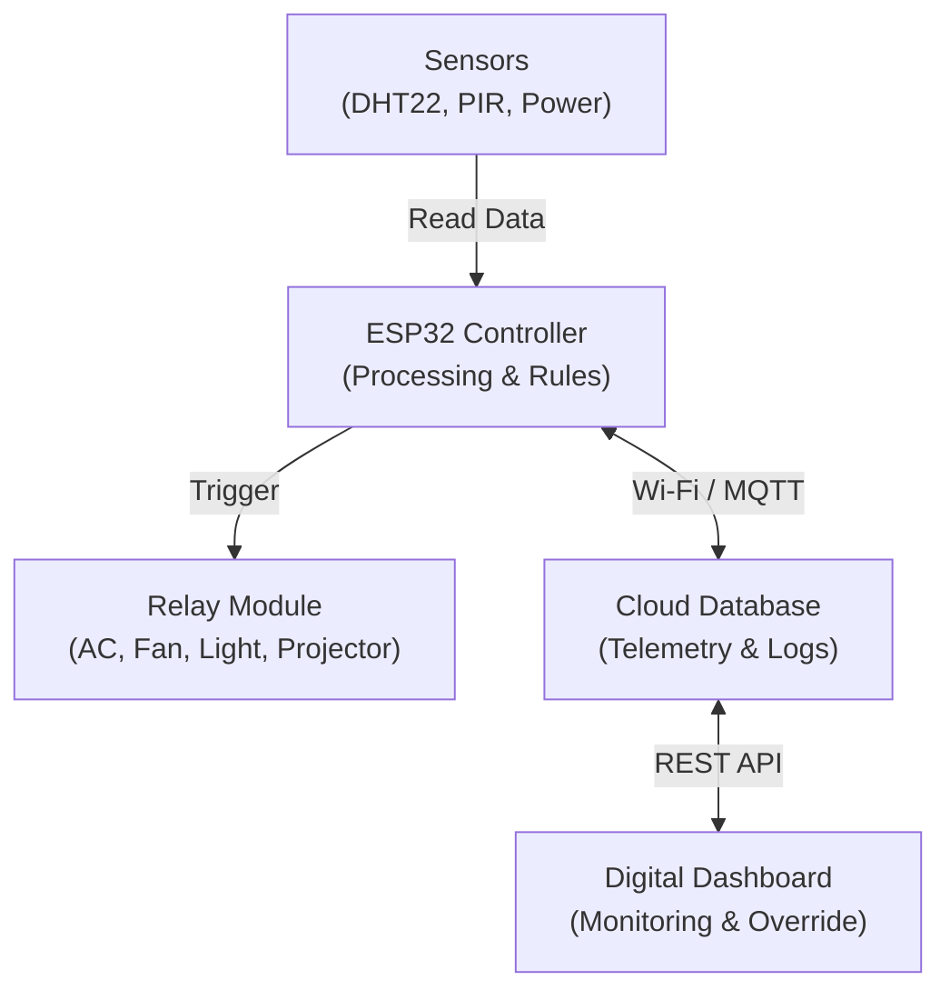

# Proposed Methodology: IoT-Based Smart Classroom Energy Monitoring and Control System

## Abstract

Energy management in modern educational institutions is critical for operational efficiency and sustainability. Unattended electrical loads such as air conditioners, fans, lights, and multimedia projectors lead to significant power waste. This document details the proposed methodology for an IoT-based smart classroom monitoring and control framework built upon an ESP32 microcontroller architecture. The system integrates environmental and occupancy sensing, multi-device control via solid-state relay arrays, cloud-based telemetry, real-time analytics dashboards, and rule-based energy management policies.

## 1 System Overview and Architecture

The proposed system is structured as an end-to-end Internet of Things (IoT) architecture comprising four primary layers: (i) Physical Sensing and Actuation Layer, (ii) Edge Controller Layer, (iii) Cloud Telemetry and Storage Layer, and (iv) Application Dashboard Layer. Figure 1 presents the structural overview of data flow and control loops within the system.

*Figure 1: System architecture for the proposed IoT-based smart classroom energy monitoring and control system.*

## 2 Proposed Methodology

The proposed system will be developed as an IoT-based smart classroom energy monitoring and control system. The system will integrate an ESP32 microcontroller, environmental and occupancy sensors, device control modules, a cloud database, and a digital dashboard to monitor and manage classroom equipment in real time.

### 2.1 1. Classroom Sensing and Data Collection

Temperature and humidity sensors will continuously monitor classroom environmental conditions, while an occupancy sensor will detect whether the classroom is occupied. Device-status and power-monitoring components will be used to track the operating condition and runtime of the AC, fan, lights, and projector.

### 2.2 2. ESP32-Based IoT Controller

The ESP32 will act as the central controller of the system. It will collect sensor data, process the readings, communicate with the cloud platform through Wi-Fi, and execute predefined device-control rules.

### 2.3 3. Multi-Device Control

The system will provide control of four major classroom devices:

- **Air Conditioner (AC):** The AC control will consider occupancy and environmental conditions.
- **Fan:** Fan control will consider occupancy and environmental conditions.
- **Lights:** Lights will be controlled according to classroom occupancy and configured operating rules.
- **Projector:** Projector operation will support controlled and manual operation with appropriate shutdown logic.

**Table 1: Classroom Equipment Control Matrix and Automation Parameters**

| Device | Control Hardware | Operational Condition | Shutdown Logic |
|---|---|---|---|
| Air Conditioner | IR / Relay Module | Occupied and High Temp | Delayed off timer |
| Fan | Relay Module | Occupied and Temp Threshold | Instant / Short Delay |
| Lights | Multi-channel Relay | Occupied and Ambient Light Low | Timeout on unoccupied |
| Projector | Relay / Smart Command | Manual / Active Session | Controlled cool-down cycle |

### 2.4 4. Automated Energy Management

The system will use occupancy and environmental information to reduce unnecessary device operation. When the classroom is unoccupied, unnecessary devices can be switched off according to predefined rules. When the classroom is occupied, device operation will be determined by the configured classroom conditions and control policies.

Mathematically, the operational state \(S_d(t) \in \{0,1\}\) for device \(d\) at time \(t\) is governed by:

$$
S_d(t)=
\begin{cases}
f_d(T(t), H(t), L(t)), & \text{if } O(t)=1 \\
0, & \text{if } O(t)=0 \text{ for } \tau \ge \Delta t_{\text{threshold}}
\end{cases}
\tag{1}
$$

where \(O(t) \in \{0,1\}\) represents classroom occupancy status, \(T(t)\) is temperature, \(H(t)\) is humidity, and \(L(t)\) is ambient illuminance.

### 2.5 5. Digital Dashboard

A digital dashboard will be developed to provide centralized monitoring and control. The dashboard will display real-time temperature, humidity, occupancy status, and the operating status of the AC, fan, lights, and projector.

It will also provide:

- Remote device control
- Device runtime monitoring
- Energy-consumption information
- Historical data visualization
- Control-action records
- Manual override functionality

### 2.6 6. Cloud Data Storage and Logging

Sensor readings, device status, runtime information, and control actions will be transmitted through Wi-Fi and stored in a cloud database. The stored data will support historical monitoring, device-wise analysis, and evaluation of energy-saving performance.

### 2.7 7. Prototype Development

A low-cost prototype will be developed using an ESP32, sensors, relay/control modules, miniature electrical loads, and supporting circuitry. The prototype will demonstrate the operation of the proposed smart classroom system before considering deployment with full-scale classroom equipment.

### 2.8 8. System Testing and Evaluation

The prototype will be evaluated under different classroom conditions, including occupied and unoccupied states and different environmental conditions. The evaluation will focus on:

- Sensor monitoring accuracy
- Device control response
- Occupancy detection
- Dashboard performance
- Device runtime logging
- System reliability
- Energy consumption and potential energy savings

The system’s energy-saving performance will be evaluated by comparing device operation and energy consumption under conventional and automated control conditions:

$$
\text{Energy Saving Ratio (\%)} =
\frac{E_{\text{conventional}} - E_{\text{automated}}}
{E_{\text{conventional}}}
\times 100\%
\tag{2}
$$

## 3 Conclusion

The proposed methodology outlines a practical, scalable, and cost-effective IoT solution for classroom energy automation. Through continuous sensing, edge processing via ESP32, multi-device relay actuation, and cloud-connected user dashboards, the system ensures real-time control, detailed runtime analysis, and measurable power conservation.
